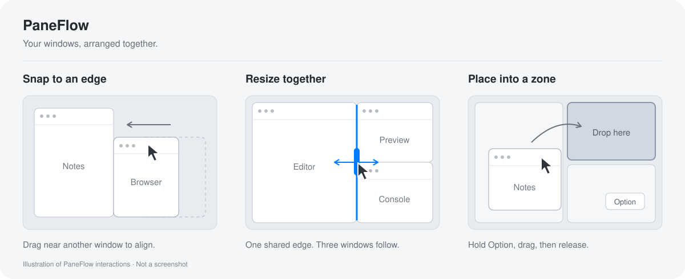

# 窗合 · PaneFlow

一个独立的 macOS 菜单栏窗口工具。自定义布局、窗口磁吸、共享边界联动缩放，以及分区放置与交换。它通过公开的 AppKit 和辅助功能接口控制普通窗口。



示意图使用虚构窗口，不是系统截图。PaneFlow 只排列你选择的窗口，不接管全局自动平铺。

目前处于开发阶段，应用使用本地签名；尚未提供公证的安装包。

已有本地 DMG 安装包时，双击打开，将 `PaneFlow.app` 拖到 `Applications`，再从“应用程序”启动。辅助功能权限按应用中的提示开启。

## 开始使用

需要 macOS 14+、Swift 6.0+ 的 Xcode 或 Command Line Tools。从源码构建：

```sh
/bin/zsh scripts/build-app.sh
open build/PaneFlow.app
```

1. 打开 `build/PaneFlow.app`。设置窗口会显示，图标保留在菜单栏；关闭设置后应用继续运行，再次双击应用会重新显示设置，最小化后也会恢复。
2. 查看设置中的辅助功能状态；若显示“未允许”，点击“开启辅助功能”，在“系统设置 → 隐私与安全性 → 辅助功能”中允许“PaneFlow”。已授权时显示“已允许”。
3. 从菜单栏打开“练习窗口”，先用三个专用窗口体验。
4. 从菜单栏选择“打开布局面板”。也可以选中一个窗口后按 `Control–Option–Space`，或按住 Option 悬停绿按钮。
5. 选择布局，点击一个区域放置当前窗口；已有窗口时交换位置。也可以勾选多个窗口，点击“排列并联动”，按列表顺序填入分区。

已有窗口管理器使用相同快捷键时，菜单栏入口仍可用。普通绿按钮点击继续由 macOS 处理。

布局面板使用系统磨砂材质和指向标题栏的圆滑箭头，随屏幕空间选择上方或下方展开。顶部的图标、标题和留白可直接按住拖动。放置或排列成功后自动收起；点击外部、按 Esc 或再次按 `Control–Option–Space` 也会收起，窗口联动仍然保留。布局菜单展开时 Esc 先关闭菜单；调整失败时面板保留并显示原因。“自定义…”会收起面板并打开独立编辑器。也可从应用菜单选择“设置…”或按 `Command–,` 打开设置。

### 绿按钮入口

macOS 绿按钮原生菜单中的项目不支持在 PaneFlow 内修改。PaneFlow 的自定义布局位于独立面板：按住 `Option` 悬停绿按钮，或用 `Control–Option–Space` 打开；在“自定义布局…”中编辑分区。普通悬停和点击仍使用系统行为。使用系统菜单排列窗口不会自动创建 PaneFlow 联动组。

## 四个模块

- 自定义布局：内置左右、上下、左宽右窄、一大两小。编辑器支持选择区域继续左右/上下拆分，拖动分隔条或输入百分比，再命名保存。最多 16 个区域。
- 窗口磁吸：普通标题栏拖动时，对其他可见窗口贴边、对齐。吸入距离 14 pt，拉开超过 26 pt 解除；按住 Control 临时跳过。窗口磁吸不会创建关联组。
- 联动缩放：主动放入同一布局的窗口才关联。拖动窗口之间的灰色分隔条，或拖动窗口的共享边缘，邻窗一起调整。分隔条使用系统磨砂材质，悬停时显示把手与缩放光标，拖动时高亮。只在组内应用处于前台、窗口符合当前布局且共享边界未被遮挡时显示。设置和布局面板会显示关联状态及分隔条未显示的原因。拖出布局、单独改变外边缘会解除该窗口的关联。
- 分区与交换：按住 Option 拖动窗口标题栏，显示当前布局区域。松手放入空区域，或与占用窗口交换。跨组交换同时更新两组；从布局外拖入占用区域时，占用窗口移至拖入窗口原来的位置。

菜单栏提供撤销（最近 20 次成功操作）、暂停和退出。设置可独立开关磁吸、联动、分区和绿按钮入口，并调整间距与留边。新设置的窗口间距默认为 0 pt，窗口之间无缝排列。

“左边一个、右边两个”可选择“一大两小”，勾选三个窗口后点击“排列并联动”。左右共享边界有上下两个竖向分隔条，拖动任意一个都会同步调整左窗和右侧两窗；右侧还有一个横向分隔条，用于调整上下比例，左窗保持原样。想让左右各占一半，可在布局编辑器中将最外层左右比例设为 50%。

保存布局只保存形状，不会关联已经手工摆好的窗口。窗口关联仅保留到应用退出；重启后需再次排列窗口建立联动。贴边磁吸独立生效，长窗口也可吸附到两扇短窗口的边缘。

## 辅助功能权限

构建产物使用本地 ad-hoc 签名，重新构建后 macOS 可能要求重新开启辅助功能权限。应用启动后会显示当前权限状态。

如果重新构建后，系统设置开关已开启，但当前应用仍提示无权限，先退出 PaneFlow。可用下面的系统命令清除 PaneFlow 的旧授权记录，再打开当前应用，点击“开启辅助功能”，开启新生成的 PaneFlow 条目。这会重置本应用的辅助功能授权。

```sh
tccutil reset Accessibility app.paneflow.window-manager
```

## 兼容性与本地数据

只处理当前桌面上公开了可移动、可缩放辅助功能接口的普通窗口。全屏、最小化、隐藏、对话框和不可调整窗口不参与。普通多显示器坐标、缩放、菜单栏和 Dock 的可用区域均参与布局计算；不包含显示器断连/重连恢复，也不接管全局自动平铺。

应用可能拒绝某个尺寸或延迟调整。拖动预览合并最新鼠标位置，已确认响应的窗口可在同一轮完成两个方向的调整；分隔条随预览移动，松手校验期间保持可见。延迟过大的应用仍在松手后完成最终校验；失败时尝试恢复拖动前的位置。恢复失败会解除相关窗口联动并明确提示。应用未暴露的尺寸下限不能预先保证，实际写入与回读结果决定能否应用。

Edge 和自带练习窗口调整期间会临时暂停其增强辅助功能模式，以减少逐次窗口写入的动画延迟，结束后回读确认恢复；VoiceOver 或切换控制启用时保留该模式。拖动中暂停管理会解除受影响窗口的旧关联，保留其当前位置。

布局形状和设置保存在 `~/Library/Application Support/PaneFlow/preferences.json`。活窗口身份与关联组仅保存在内存中；设置文件不保存窗口标题、内容、键盘输入或截图。鼠标监听只用于判断窗口拖动与修饰键，不记录输入。没有账号、网络、遥测或开机启动设置。

布局入口是绿按钮旁的独立面板。不会向其他应用注入代码，不更改系统原生菜单，不要求关闭 SIP。

## 开发与贡献

项目使用 Swift Package Manager，没有第三方包依赖。目录结构、独立构建输出、核心/界面/原生验证和源码打包见 [开发说明](docs/DEVELOPMENT.md)。参与修改或报告问题请阅读 [贡献说明](CONTRIBUTING.md)；版本改动见 [变更记录](CHANGELOG.md)。

## 许可与来源

PaneFlow 使用 [MIT 许可证](LICENSE)。`WindowFrameDriver.swift`、`FrameSettler.swift` 来自 PaneGrid，保留其 MIT 许可与署名；完整文本见 [NOTICE-PaneGrid](NOTICE-PaneGrid)，来源提交见 [来源说明](docs/THIRD_PARTY.md)。
